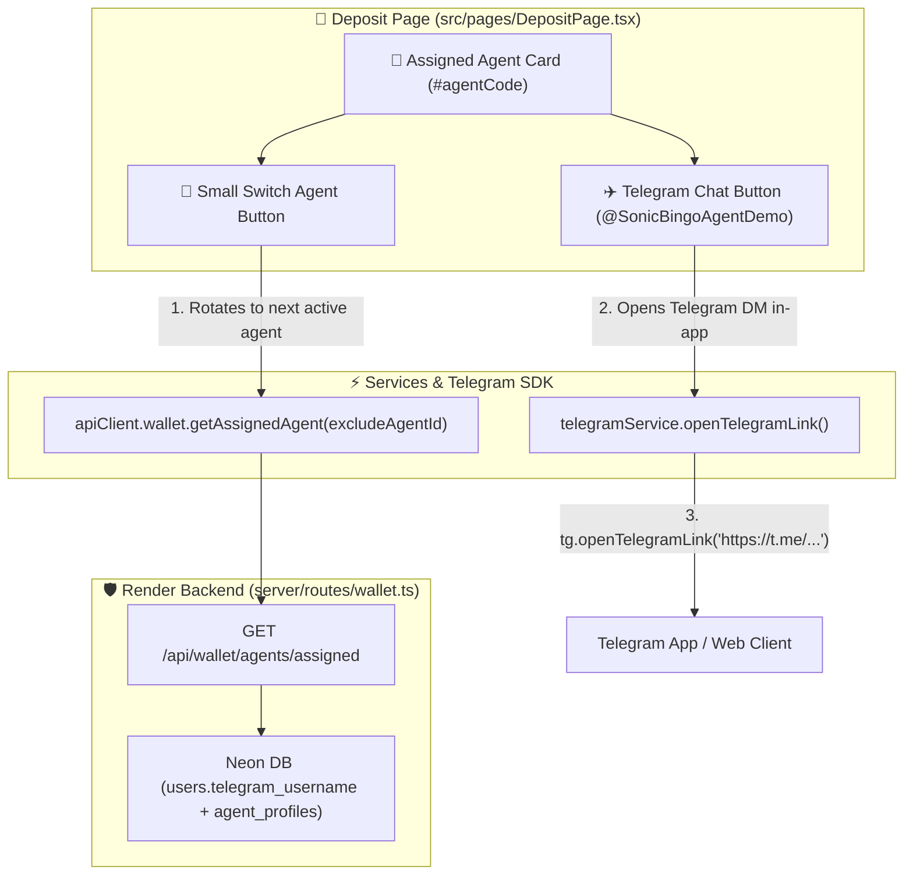

# 📋 Implementation Plan: Deposit Agent Switch Button & Telegram Direct Redirect

## 📌 Executive Summary
The user requested two key enhancements to the Deposit experience:
1. **Small "Switch Agent" Button**: Provide a compact, easily accessible button directly on the Agent Card so users can effortlessly switch/rotate between certified agents.
2. **Direct Telegram Account Redirect Button**: Add a Telegram contact button on the Agent Card that redirects the player to the assigned agent's Telegram account (`https://t.me/<username>`), using a demo account (`@SonicBingoAgentDemo` / `@SonicSupportDemo`) for testing and demonstration.

---

## 🔍 Architecture & Component Flow



---

## 📐 Detailed Implementation Breakdown

### 1. Backend: Agent Telegram Resolution (`server/routes/wallet.ts`)
- **Query Enhancement**:
  In `GET /api/wallet/agents/assigned` and `GET /api/wallet/agents/active`:
  ```sql
  SELECT ap.id, ap.agent_code, ap.status, 
         ap.telebirr_phone, ap.telebirr_name, 
         ap.mpesa_phone, ap.mpesa_name,
         ap.active_rails, 
         COALESCE(ap.is_online, true) as is_online, 
         ap.wallet_balance,
         u.full_name, u.phone as user_phone,
         u.telegram_username
  FROM agent_profiles ap
  JOIN users u ON ap.user_id = u.id
  ```
- **Demo Fallback**:
  Format response so each agent includes `telegramUsername`:
  ```ts
  telegramUsername: (a.telegram_username && a.telegram_username.trim()) || 'SonicBingoAgentDemo',
  ```
  This ensures that if the agent has a registered Telegram username, it is used; otherwise, it cleanly defaults to the demo account.

### 2. Frontend API Client (`src/services/apiClient.ts`)
- Add `telegramUsername?: string;` to `agent` interface inside `getAssignedAgent()`.

### 3. Frontend UI: Interactive Agent Card Actions (`src/pages/DepositPage.tsx`)
Inside `.sonic-assigned-cashier-card`:
- **Small "Switch Agent" Button (`.sonic-agent-card-switch-btn`)**:
  - Positioned neatly in the card header / action row.
  - Small, high-contrast, polished gold border pill.
  - Visual loading state (`fa-spin` on icon when switching).
  - Works anytime: calls `handleReRollAgent()` which excludes the current agent and pulls the next certified cashier.
- **Telegram Contact Button (`.sonic-agent-card-telegram-btn`)**:
  - Prominently styled in official Telegram blue (`#24A1DE`) with luminous glass highlight.
  - Displays: `<i className="fa-brands fa-telegram"></i> Telegram` or `@SonicBingoAgentDemo`.
  - Tapping invokes `telegramService.openTelegramLink(`https://t.me/${cleanUsername}`)`.
  - Also displays an instant Amharic/English tooltip/helper: `"ኤጀንቱን በቴሌግራም ያናግሩ / Chat with agent on Telegram"`.

### 4. CSS Design & Styling (`src/styles/deposit_clone.css`)
- Add scoped styling:
  - `.sonic-agent-card-actions`: Flexible horizontal strip inside the card.
  - `.sonic-agent-card-switch-btn`: Compact dark/gold accent button (padding: 4px 10px, font-size: 11px, border-radius: 8px).
  - `.sonic-agent-card-telegram-btn`: Telegram cyan-blue gradient button (`linear-gradient(135deg, #2AABEE 0%, #229ED9 100%)`), 11.5px font-weight 700.
  - Smooth scale on tap/hover, perfect mobile touch ergonomics.

---

## 🧪 Verification & Automated Testing Plan
- Create `server/scripts/test_deposit_agent_switch_and_telegram.ts`:
  1. Verify `GET /api/wallet/agents/assigned` returns `telegramUsername` (with demo fallback `'SonicBingoAgentDemo'`).
  2. Verify `DepositPage.tsx` includes the small switch agent button and Telegram redirect button.
  3. Verify `telegramService.openTelegramLink` is called with sanitized URL (e.g. `https://t.me/SonicBingoAgentDemo`).
  4. Run full TypeScript check (`npx tsc --noEmit`).
  5. Run production Vite build (`npm run build`).

---

## 🚀 Execution Phases

| Phase | Description | Status |
| :--- | :--- | :---: |
| **Phase 1** | Backend update: return `telegramUsername` with demo fallback in `wallet.ts` | ⏳ Pending Approval |
| **Phase 2** | Update `apiClient.ts` agent type definition | ⏳ Pending Approval |
| **Phase 3** | Add small Switch Agent button & Telegram redirect button to `DepositPage.tsx` | ⏳ Pending Approval |
| **Phase 4** | Add styling in `src/styles/deposit_clone.css` | ⏳ Pending Approval |
| **Phase 5** | Create automated test suite, verify regressions, build & commit | ⏳ Pending Approval |

---

## ❓ Ready to Proceed?
Please review this implementation plan. When you are ready, simply reply with **"proceed"** to begin execution!

