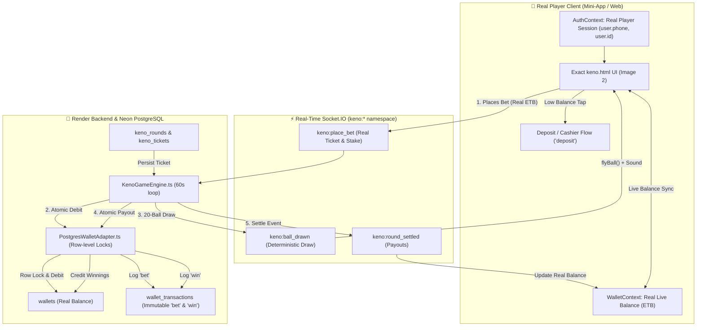

# 🎰 Exact Fast Keno UI & Real Account Money Integration Plan

> **Objective**: Completely replace the modified React UI (Image 1) with the **exact, pixel-perfect original UI and animations from `keno.html` (Image 2)**, wired directly to **real authenticated player money**, atomic wallet balance deductions and payouts, real user account ID, deposit navigation, and real-time Socket.IO synchronization—functioning identically to the Bingo cash system with **zero mock data** and **zero interference with Bingo**.

---

## 📌 1. Executive Summary & Core Changes

### 💎 What "Like Bingo" Means for Fast Keno:
1. **Real Account Money**: The balance displayed in the header (`#bal` and `#bal2`) is NOT dummy `22.30 ETB`. It is the player's **actual live ETB balance** from `WalletContext` and Neon PostgreSQL (`wallets.balance`).
2. **Real Account Identity**: The ID displayed (`#uid` and `#uid2`) is the player's **real account phone/ID**, not a random dummy number.
3. **Real Deposit / Cashier Access**: Clicking on the balance pill or attempting to bet with insufficient funds opens the real **Deposit modal** (`switchPage('deposit')`), just like in Bingo.
4. **Atomic Real ETB Bets & Wins**:
   - Betting $S$ ETB immediately debits real money using `PostgresWalletAdapter` with `SELECT ... FOR UPDATE` row locks and logs a `'bet'` row into `wallet_transactions`.
   - Winning credits real money immediately, logs a `'win'` row into `wallet_transactions`, and instantly updates the balance across Bingo, Wallet, and Keno.
5. **Exact Visual Match (Image 2 / `keno.html`)**:
   - 100% of the authentic CSS styles, fonts (`Orbitron`, `Roboto Condensed`), radar concentric arcs, mini ball badges, hot/cold dots on cells, betting row `[-] 2 [+]` `X2` `MAX`, 62px `BET` button, live ticket cards, emerging ball tube animation with flight into 20 slots, in-stage `YOU WIN` banner, and rules/fairness modal.
   - Deletion of all unapproved custom controls (quick-spot buttons, extra stake pills).

---

## 🏛️ 2. Real Account Money & Architecture Flow

---

## 🗓️ 3. Phase-by-Phase Implementation Roadmap

---

### 🚀 Phase 1: Real Account Money & Authenticated Wallet Bridge
**Goal**: Wire the Keno game state directly to the user's real wallet and auth session, matching Bingo's real-money behavior.

- [ ] **1.1. Connect `WalletContext` & `AuthContext` to `KenoContext`**:
  - Replace any remaining fallback state with `useWallet()` and `useAuth()`.
  - Expose `realBalance`: current ETB balance from `wallets` table in Neon DB.
  - Expose `userIdentifier`: real phone number or formatted account ID (e.g., `091****89` or `ID: 886122631`).
  - Provide `openDeposit()`: triggers `switchPage('deposit')` when the player taps the balance pill or has insufficient funds.
- [ ] **1.2. Real Stake Validation & Atomic Debit**:
  - Before emitting `keno:place_bet`, check if `stake <= realBalance`. If not, show toast `"Not enough credits. Please deposit"` and prompt deposit.
  - On confirmation, emit `keno:place_bet` to server.
  - `PostgresWalletAdapter.deductBet()` executes inside a PostgreSQL transaction (`SELECT balance FROM wallets WHERE user_id = $1 FOR UPDATE`), verifying the live DB balance, deducting the exact stake, and creating an immutable record in `wallet_transactions` with `type = 'bet'`.
  - Immediately refresh and sync `WalletContext.balance` so that header, profile, and Bingo balances update simultaneously.
- [ ] **1.3. Real Round Settlement & Payout Credits**:
  - When a round finishes, `KenoGameEngine` evaluates all tickets against the drawn 20 balls using the official Atlas-V paytable.
  - For winning tickets, `PostgresWalletAdapter.creditWin()` atomically credits the real ETB winnings to the player's wallet and records `type = 'win'` in `wallet_transactions`.
  - Broadcasts `keno:round_settled` to client, updating the real player wallet balance and displaying the in-stage `YOU WIN` banner.
- [ ] **Phase 1 Acceptance Criteria**:
  - A real user with 50 ETB places a 10 ETB bet $\rightarrow$ wallet balance immediately becomes 40 ETB in Neon DB and on screen.
  - Winning a 20 ETB payout $\rightarrow$ wallet balance immediately becomes 60 ETB.
  - Tapping the balance pill opens the deposit modal.

---

### 🎨 Phase 2: Exact CSS & Visual Asset Restoration
**Goal**: Restore 100% of the authentic styles, layouts, responsive sidebars, animations, and background assets from `keno.html` (Image 2).

- [ ] **2.1. Complete Replacement of `src/styles/keno.css`**:
  - Paste the exact 597 lines of pure CSS from `keno.html`.
  - Retain all root color variables:
    - `--bg: #141b1a; --panel: #1f2928; --tile: #2e3839; --slot: #262f2e;`
    - `--g: #3ddc97; --g2: #52c280; --y: #f5c542; --r: #ff4d4d; --b: #3fa9f5;`
  - Retain all fonts: `Orbitron`, `Roboto Condensed`, `Roboto`.
- [ ] **2.2. Background Overlays & Luxury Casino Textures**:
  - Restore `body::before` WebP radar overlay (embedded base64).
  - Restore `body::after` casino luxury background texture (embedded base64).
- [ ] **2.3. Responsive 3-Column Desktop Grid**:
  - Restore `.wrap` with `@media (min-width: 900px)`:
    - Left column (285px sticky sidebar): Player card, balance badge, `GAME` / `HISTORY` tabs.
    - Center column (560px max): Main Keno stage, 80-ball grid, bet controls, 62px `BET` button.
    - Right column (290px sticky sidebar): `RESULTS` / `STATISTICS` / `LEADERS` tabs.
  - Mobile column ($\le 430\text{px}$): Single streamlined column with bottom navigation tabs.
- [ ] **Phase 2 Acceptance Criteria**:
  - CSS compiles without errors and exactly matches `keno.html`.
  - Side-by-side visual check shows 1:1 match with Image 2 (`media_1794946655754_799cfcc7.jpg`).

---

### 🕹️ Phase 3: Pixel-Perfect Component Port (`src/pages/KenoPage.tsx`)
**Goal**: Replace the deviated Phase 3 React markup with the exact HTML structure from `keno.html`, bound to real data.

- [ ] **3.1. Header & Discreet Lobby Return**:
  - Render exact header: `.logo` (`FAST KENO`), `.pill` (real ETB balance + real user ID + teal shield SVG), and `.menu` (3 green bars).
  - Add discreet `← Lobby` pill button on far left that navigates back to Bingo lobby (`switchPage('bingo')`) without breaking header layout.
- [ ] **3.2. Authentic Timer**:
  - Render `.timer` (`00 : 18`) with dark bottom-rounded badge and green shadow glow.
- [ ] **3.3. Concentric Arc Radar Stage (`.stage#stage`)**:
  - Render SVG concentric arcs (`.arcs`).
  - **Slide 1 (`#pickView`)**: Mini balls (80 & 10), green circular badge `1` (`.n`), text `"Choose 10 numbers"` and `"From 1 to 80"`, and `?` help button.
  - **Slide 2 (`#infoView`)**: Displays when numbers are selected, showing `"Possible win"`, dynamic odds columns (`.odds`, `.oc`), and 10 slot boxes (`.slotsrow`).
  - **Slide Carousel (`.slides`, `.pgd`)**: Horizontal scrollable slides with pagination dots for every active ticket placed in the current round.
- [ ] **3.4. 80-Ball Grid (`.grid`)**:
  - Render 80 cells (`.cell`) with aspect ratio `1/.9`.
  - Display red dots (`.dot.r`) on HOT numbers and blue dots (`.dot.b`) on COLD numbers (calculated from real Neon DB round history).
  - Selected numbers turn green (`.sel` / `#52c280`).
  - Hit numbers turn glowing bright green (`.hit` / `#4fd88f`).
  - Drawn numbers show subtle border (`.drw`).
- [ ] **3.5. Betting Controls (`.row`) & 62px `BET` Button**:
  - Render `.amt` with `[-]`, current stake (default 2 ETB), `[+]`.
  - Render `.sm` `X2` (doubles stake up to real balance).
  - Render `.sm` `MAX` (sets max stake to 500 ETB or player balance).
  - Render big 62px `.bet` button.
  - Flash `BET ACCEPTED` with SVG checkmark for 1,000ms upon successful placement.
- [ ] **3.6. Navigation Tabs & Content Panes**:
  - Render tab bar: `▶ GAME`, `⟲ HISTORY`, `✓ RESULTS`, `📊 STATISTIC`, `👑 LEADERS`.
  - Render real ticket cards (`.tk`) with 10 `.slots` boxes and status badge (`Waiting` in yellow, `WON ...` in green, `0` in red).
  - Stats subheader: `All 9278` | `My Tickets` | `My Bets`.
- [ ] **3.7. Rules & Fairness Modal (`#rulesModal`)**:
  - Render UK flag header and close button `✕`.
  - Tab 1 `RULES`: Complete 10x10 payout table matching the screenshot.
  - Tab 2 `FAIRNESS`: Cryptographic commit-reveal explanation with 1-click verification of SHA-512 / Server Seed / Hash.
- [ ] **Phase 3 Acceptance Criteria**:
  - All custom quick-bet buttons (`1 Spot`, `3 Spots`, etc.) and extra pills are completely removed.
  - Page DOM structure is identical to `keno.html`.

---

### ⚡ Phase 4: Real-Time Sockets, Ball Tube Animation & Procedural Audio
**Goal**: Wire the stage animations and sounds to live backend events.

- [ ] **4.1. Drawing Stage Expansion & Tube Animation**:
  - When backend enters `drawing` phase, stage expands with `.stage.drawing`.
  - Counter displays `00 / 20`.
  - As each ball is received via `keno:ball_drawn`:
    - Ball emerges in central tube (`.ball.big.emerging`) inside `.glow`.
    - Synthesized pop sound (`playPopSound()`) and hit chime (`playHitChime()`) trigger.
    - 1,000ms showcase pause, then `flyBall()` animates into the 20-slot docking tray (`.drawn`).
- [ ] **4.2. In-Stage Settlement Banner**:
  - If player won: Central tube hides and displays `.win-stage-banner` with `YOU WIN` and the exact ETB amount in glowing green, triggering victory fanfare.
  - If player lost: Displays `TRY AGAIN`.
  - 6-second celebration pause before transitioning smoothly into next round's betting phase.
- [ ] **4.3. Procedural Web Audio Engine**:
  - Incorporate the RAM synthesizer from `keno.html` using browser Web Audio API oscillator nodes (0 external audio files, $0.00 bandwidth).
- [ ] **Phase 4 Acceptance Criteria**:
  - Live round displays synchronized countdown and ball calls.
  - Sound plays crisply on both mobile and desktop.
  - Winnings credit to real wallet in real time.

---

### 🛡️ Phase 5: Complete E2E Financial Audit & Bingo Regression Firewall
**Goal**: Rigorously verify that real money moves accurately and zero regressions occur in Bingo.

- [ ] **5.1. Real-Money Lifecycle Audit Script**:
  - Run automated script testing real user authentication, balance deduction on bet, atomic win credit, and transaction log creation in `wallet_transactions`.
- [ ] **5.2. Cross-Game Balance Invariant Test**:
  - Verify that deducting 10 ETB in Keno immediately reflects in Bingo lobby, profile, and admin cashier ledger without page refresh.
- [ ] **5.3. Bingo Invariant Regression Suite**:
  - `npx tsx server/scripts/test_night_zero_bot_waiting.ts` (6/6 PASS)
  - `npx tsx server/scripts/test_room10_hourly_schedule.ts` (100% PASS)
  - `npx tsx server/scripts/test_phase3_dynamic_probability.ts` (100% PASS)
  - `npx tsx server/scripts/test_agent_pwa_and_zero_regressions.ts` (24/24 PASS)
  - `npx tsc --noEmit` (0 errors)
  - `npm run build` (Clean production bundle)
- [ ] **5.4. Git Commit & Push**:
  - Stage, commit, and push updates to `origin main`.

---

## 📊 Summary of Phase Execution Order

| Phase | Description | Key Deliverable | Real Money Status |
| :---: | :--- | :--- | :---: |
| **Phase 1** | Real Account Money & Auth Wallet Bridge | `KenoContext.tsx` + `PostgresWalletAdapter.ts` | **Real ETB Live** |
| **Phase 2** | Exact CSS & Visual Asset Restoration | `src/styles/keno.css` (597 lines) | Styled to Image 2 |
| **Phase 3** | Pixel-Perfect Component Port | `src/pages/KenoPage.tsx` | Exact DOM & Controls |
| **Phase 4** | Real-Time Sockets, Ball Tube & Audio | `flyBall()`, Web Audio, `keno:*` events | Live Draw & Settle |
| **Phase 5** | E2E Financial Audit & Bingo Regression | Automated test suites & Git push | **Verified & Deployed** |
