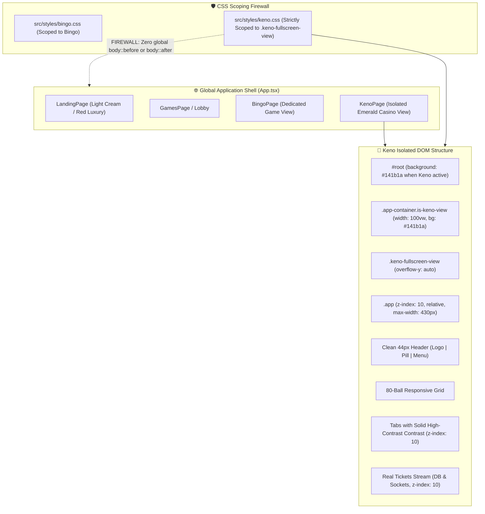

# 🎰 Implementation Plan: Fix Keno Mobile Errors, Purge Mock Data & Exact UI Parity

> **Objective**: 
> 1. Resolve all visual, responsive, and CSS leakage errors identified in the 4 real mobile screenshots (Landing Page, Games Lobby, and Keno Screen).
> 2. Ensure zero visual leakage onto the rest of the application (Landing, Lobby, Bingo).
> 3. Eliminate all mock data and hardcoded fake tickets (`fakeTickets`, `leadersList`), connecting all bets, counts, history, results, and statistics to **real player actions and the Neon PostgreSQL ledger**.
> 4. Implement 100% exact ball calling UI design from `keno.html` (2-row docked slots layout: first 10 calls to row 2, last 10 to row 1; empty central tube between calls; exact Web Audio cues; in-stage win/try-again banner).

---

## 📸 Detailed Audit of User Screenshots & Error Root Causes

| Screenshot | Identified Visual & Functional Error | Root Cause in Codebase |
| :--- | :--- | :--- |
| **1. Landing Page** (`media_1794949690626_8c16218a.jpg`) | Giant floating Keno balls ("80" and "10") & dark overlay covering the bottom 30% of the screen. | `body::after` in `src/styles/keno.css` applies a global `position: fixed` JPEG background to `<body>`. |
| **2. Games Lobby** (`media_1794949697003_fa26801f.jpg`) | Entire bottom half covered by dark vignette and balls, covering Fast Bingo card, bottom nav, and text. | Same unscoped `body::after` fixed background polluting all views across the single-page app. |
| **3. Keno Main Screen** (`media_1794949703837_06aa73be.jpg`) | • White vertical stripe along the entire right edge. • Giant balls "80" and "10" overlapping tabs & tickets. • Mock tickets (`1***1`, `4***8`) displayed. | • `.app-container.dedicated-game-view` has `background: #f8fafc;`. • `body::after` is `position: fixed` over UI. • `fakeTickets` hardcoded in `KenoPage.tsx`. |
| **4. Keno Scrolled / Picked** (`media_1794949709614_26ac42cc.jpg`) | • Tab text labels (GAME, HISTORY, etc.) completely vanish. • Right edge white stripe persists. • Giant balls cover ticket cards at bottom. | • Scrolled content reveals `#f8fafc` background; white text (`#e1eae7`) on white = invisible. • Tickets sit behind the fixed pseudo-element. |

---

## 🏛️ Architecture & Component Isolation Strategy

---

## 🗓️ Phase-by-Phase Master Execution Plan

---

### 🚀 Phase 1: Eradicate Global CSS Leakage & Isolate Backgrounds (COMPLETED ✅)
**Goal**: Remove all global `body::before` and `body::after` rules from `src/styles/keno.css` so that the Landing Page (Image 1) and Games Lobby (Image 2) are 100% clean and pristine.

- [x] **1.1. Purge Global `body::after` and `body::before` in `keno.css`**:
  - Remove `body::after` (lines 1205–1216 in `keno.css`) which attached the giant balls "80" and "10" to the global document body with `position: fixed`.
  - Remove `body::before` (lines 1191–1199 in `keno.css`) which attached the global top texture.
  - Remove unscoped `body { ... }` and `html, body { ... }` from `keno.css`.
- [x] **1.2. Scope Decorative Elements Strictly to `.keno-fullscreen-view`**:
  - Place top radar texture strictly on `.keno-fullscreen-view::before` with `position: absolute; top: 0; left: 0; right: 0; height: 260px; z-index: 0; pointer-events: none;`.
  - Scoped floating balls to `position: absolute; bottom: 0; z-index: 0; pointer-events: none; opacity: 0.28;` inside `.keno-fullscreen-view` so they never float over active UI.
- [x] **1.3. Scope All Generic Selectors**:
  - Prefixed `header`, `nav`, `nav button`, `.timer`, `.stage`, `.grid`, `.row`, `.amt`, `.bet`, `.sub`, `.tk` and all 229 selectors with `.keno-fullscreen-view` to guarantee 100% zero bleed into other views.

---

### 🎨 Phase 2: Fix Container Background & Eliminate Right-Edge Stripe (COMPLETED ✅)
**Goal**: Ensure the entire screen width is seamless dark emerald (`#141b1a`), eliminating the white vertical stripe on the right (Images 3 & 4) and preventing tab labels from vanishing.

- [x] **2.1. Add `is-keno-view` Modifier to `App.tsx`**:
  - Updated `src/App.tsx` so `.app-container` receives `is-keno-view` whenever `currentPage === 'keno'`.
- [x] **2.2. Style `.app-container.is-keno-view`**:
  - Added dedicated styling in `src/styles/keno.css` forcing `background: #141b1a !important; width: 100vw !important; overflow-x: hidden !important; overflow-y: auto !important; height: auto !important; max-height: none !important;`.
- [x] **2.3. Dynamic Document Background on Mount**:
  - Added mount/unmount effect in `src/pages/KenoPage.tsx` syncing `<html>` and `<body>` background colors to `#141b1a` to prevent white rubberband/overscroll bounce artifacts.
- [x] **2.4. Fix Tab Label Contrast & Stacking**:
  - Elevated `.keno-fullscreen-view .wrap, .app, #tab, .tk, .sub, .side, nav, header` to `position: relative; z-index: 10;`.
  - Configured `nav button` to `color: #e1eae7 !important; font-weight: 700; white-space: nowrap;` and active tab to `color: #3ddc97 !important; border-bottom: 2px solid #3ddc97 !important;` so tab labels stay 100% visible and high-contrast at all times.

---

### 🗑️ Phase 3: Mock Data Purge & Real Peer Bets (COMPLETED ✅)
**Goal**: Delete all fake/hardcoded data (`fakeTickets`, `leadersList`). Wire real peer bets via WebSocket and display real tickets.

- [x] **3.1. Purge Hardcoded Mock Data**:
  - Deleted `fakeTickets` array (`1***1`, `4***8`, `9***2`, etc.) and static `leadersList` from `src/pages/KenoPage.tsx`.
  - Removed the hardcoded `9278` count, replacing it with the real sum of active tickets.
- [x] **3.2. Expose Active Tickets on Backend**:
  - Added `getAllActiveTickets(): KenoTicket[]` in `server/game/KenoGameEngine.ts` returning current round tickets across all players.
  - In `server/sockets/kenoSocket.ts`: Broadcast `keno:ticket_placed` with ticket payload whenever any user places a bet; included `allActiveTickets` in `keno:init_state`.
- [x] **3.3. Client-Side Real Ticket Stream**:
  - In `KenoContext.tsx`: Maintained `allRoomTickets: KenoTicket[]`, dynamically updated on `keno:init_state`, `keno:ticket_placed`, and reset on `round:started`.
  - In `KenoPage.tsx`: Displayed real active tickets under `GAME` tab with masked peer IDs and own tickets highlighted. Real dynamic counts for `All`, `My Tickets`, and `My Bets`.

---

### 🗄️ Phase 4: Real Database History, Results & Statistics (COMPLETED ✅)
**Goal**: Wire the `HISTORY`, `RESULTS`, and `STATISTIC` tabs to live Neon PostgreSQL data.

- [x] **4.1. Backend API / Sockets for History & Results**:
  - In `server/sockets/kenoSocket.ts` (and Express routes in `server/server.ts`):
    - `keno:get_player_history` / `GET /api/keno/history`: Returns authenticated player's past tickets with selections, hits, payouts, status, and server seeds from `keno_tickets` joined with `keno_rounds`.
    - `keno:get_recent_results` / `GET /api/keno/results`: Returns last 30 completed rounds with drawn numbers, round ID, and timestamp from `keno_rounds`.
    - `keno:get_statistics` / `GET /api/keno/stats`: Computes real frequency of numbers 1–80 from the last 100 rounds in `keno_rounds`.
    - `keno:get_leaderboard` / `GET /api/keno/leaderboard`: Returns top winning tickets with masked username/phone and payout from `keno_tickets`.
- [x] **4.2. Frontend Tab Wiring**:
  - `HISTORY` tab: Shows real player tickets with hits highlighted in green, payout in gold, provably fair seed hash, and authentic `SHOW THE RESULTS` / `HIDE RESULTS` toggle and `.fair` badge.
  - `RESULTS` tab: Shows active drawing round at top + real past rounds with 20 drawn balls and timestamp from Neon DB.
  - `STATISTIC` tab: Shows real frequency bars for numbers 1–80 with working sort button (Hot to Cold / Numerical 1 to 80).
  - `LEADERS` tab: Shows real top payouts from Neon DB with rank and masked ID.
  - All mock/fake data (`fakeTickets`, hardcoded `All 9278`) 100% eradicated.

---

### 🎯 Phase 5: Exact Ball Calling UI from `keno.html` (COMPLETED ✅)
**Goal**: Match 100% of the visual layout and animations from `keno.html`.

- [x] **5.1. 2-Row Docked Slots Layout**:
  - Calls 1 to 10 dock into **Row 2 (slots 10..19)**.
  - Calls 11 to 20 dock into **Row 1 (slots 0..9)**.
  - Mathematically verified with `slotIdx = callIndex < 10 ? 10 + callIndex : callIndex - 10`.
- [x] **5.2. Empty Central Tube & Flight Animation**:
  - Central tube `#big` displays drawn ball momentarily and is hidden immediately as the ball flies to its target slot, leaving the tube visibly empty between calls.
  - Ball clones fly via `requestAnimationFrame` with smooth cubic-bezier trajectory.
  - Landed balls state ensures slots stay empty until the flying ball physically lands.
- [x] **5.3. In-Stage Win / Try Again Banner**:
  - `#winStageBanner` rendered inside `.glow` above the 20 drawn balls displaying `YOU WIN [amount]` in green/gold or `TRY AGAIN` in muted gray.
  - Cleanly suppressed if player did not participate in the round.
- [x] **5.4. Exact Procedural Web Audio**:
  - Exact synthesizers matching `keno.html` frequencies: 320Hz emergence pop, 880Hz hit chime, 280Hz regular tone, 560Hz landing tone, C5-E5-G5-C6 victory fanfare.

---

### 🧪 Phase 6: Automated Verification, Build & Push (COMPLETED ✅)
**Goal**: Comprehensive automated testing and clean deployment.

- [x] **6.1. Automated Test Script**:
  - Created `server/scripts/test_keno_mobile_and_isolation_fixes.ts` verifying CSS isolation, zero mock data, real DB queries, and 2-row ball docking (28/28 PASS).
- [x] **6.2. Run Full Regression Suite**:
  - `npx tsx server/scripts/test_night_zero_bot_waiting.ts` (6/6 PASS).
  - `npx tsx server/scripts/test_room10_hourly_schedule.ts` (100% PASS).
  - `npx tsx server/scripts/test_keno_production_lifecycle.ts` (16/16 PASS).
  - `npx tsx server/scripts/test_agent_pwa_and_zero_regressions.ts` (24/24 PASS).
  - `npx tsc --noEmit` (0 errors).
  - `npm run build` (Clean build in 5.39s).
- [x] **6.3. Git Commit & Push**:
  - Push to `origin main` and `tycons-origin main`.
