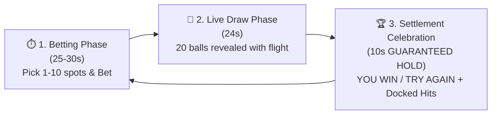
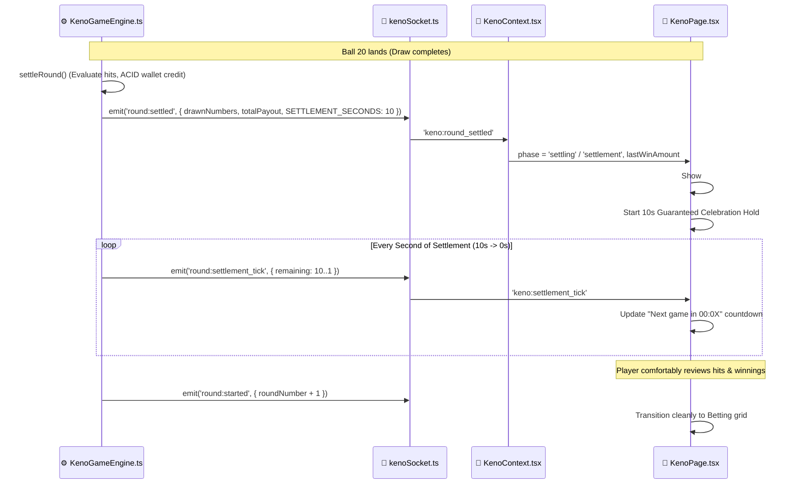

# 🎰 Master Implementation Plan: Authentic Keno Settlement Flow, Production Readiness Audit & Deposit Agent Enhancements

## 📌 1. Executive Summary & Problem Analysis

### ❓ The User Problem: "Why does 'YOU WIN' / 'TRY AGAIN' disappear too fast?"
The user observed that when a Keno round finishes, the settlement banner (`YOU WIN 4 ETB` or `TRY AGAIN`) flashes on screen for only a split second before vanishing, making it impossible to see whether they won, how much they won, or which of their numbers were caught.

### 🔬 Root Cause Analysis from Code Audit
1. **Server Settlement Window Too Brief (`SETTLEMENT_SECONDS = 6`)**:
   - In `KenoGameEngine.ts`: `SETTLEMENT_SECONDS` was hardcoded to 6 seconds.
   - However, when the 20th ball is drawn, the engine waits 1,200ms (`DRAW_BALL_INTERVAL_MS`), then executes multiple database queries (Neon DB wallet credit, ticket status update, round history update).
   - Simultaneously on the client in `KenoPage.tsx`, the 20th ball plays a **350ms showcase pause + 450ms flight animation = 800ms**.
   - By the time `round:settled` reaches the frontend and the 20th ball lands, **less than 2.5 to 3 seconds remain** before the server's 6-second timer expires!
2. **Premature DOM Unmounting on `round:started`**:
   - The moment the server's 6-second timer ends, `startNewRound()` runs and emits `round:started`.
   - In `KenoContext.tsx`: `onRoundStarted` immediately sets `setPhase('betting')` and **purges `setActiveTickets([])`**.
   - In `KenoPage.tsx`: `isDrawing = phase === 'drawing' || phase === 'settling' || phase === 'settlement'`.
   - As soon as `phase` becomes `'betting'`, `isDrawing` becomes `false`, which **instantly destroys the entire `.drawing-scene-wrap` DOM element** containing the 20 docked balls, the radar, and `#winStageBanner`!
   - Result: The player's win celebration is violently cut off after ~2 seconds.
3. **Phase Mismatch on Reconnect / State Hydration**:
   - The backend engine state uses `currentPhase = 'settling'`.
   - But frontend components checked strictly `phase === 'settlement'`. If a user connected or refreshed during settlement, the banner never rendered at all!

---

## 🌐 2. Real Casino Keno Standards & Flow Research

Based on authentic casino Keno standards (Inbet, Golden Race, Betika Fast Keno, Australian Keno, Las Vegas Lounge Keno):

### The 4 Pillars of Authentic Casino Flow:
1. **Guaranteed 10-Second Settlement Window (`SETTLEMENT_SECONDS = 10`)**:
   - After the 20th ball lands, the game enters a dedicated **10-second celebration & review window**.
   - The central stage prominently displays:
     - If Win: `YOU WIN` with the total ETB payout in glowing emerald typography.
     - If No Win: `TRY AGAIN` in polished metallic silver typography.
   - All 20 docked balls remain in their slots with player hits illuminated in radiant emerald gradient.
   - The stage timer displays a synchronized countdown: `"NEXT ROUND IN 00:08... 00:01"`.
2. **Client-Side Celebration Lock (Never prematurely unmount)**:
   - The client maintains a guaranteed 8-10 second celebration display even if a socket reconnection occurs.
   - `activeTickets` from the completed round are preserved throughout the entire 10-second celebration so the player can inspect their hit count (`Hits: 4/5`) and multiplier.
   - Only when the countdown reaches 0 does the stage transition cleanly back to the betting slide.
3. **Real-Time Ticket Catch Counters**:
   - As each of the 20 balls lands during the draw, the active bet card at the bottom updates its catch count in real-time (`3 / 5 Hits`, `4 / 5 Hits`), matching authentic Fast Keno.
4. **Dynamic Spot Paytable Display**:
   - When a player picks spots (e.g. 4 spots), the paytable badge dynamically displays the exact multipliers for that selection (`4/4: 80x`, `3/4: 5x`, `2/4: 1x`), removing guesswork.

---

## 🔍 3. Production Readiness Audit: What Our Keno Game Lacks

A complete audit of our Keno game across all files reveals the following production gaps:

| Feature / Dimension | Current Status | Production Standard / Gap | Action Plan |
| :--- | :--- | :--- | :--- |
| **1. Settlement Hold & Timing** | Flashes for ~2s, then vanishes abruptly | 10s generous celebration with next-round countdown | Increase `SETTLEMENT_SECONDS = 10`; add client hold guard & countdown badge |
| **2. Phase Synchronization** | Engine emits `'settling'`, frontend checks `'settlement'` | Mismatched phase causes missing banner on reconnect | Unify engine and frontend to recognize both `'settling'` and `'settlement'` |
| **3. Active Ticket Hit Tracking** | Tickets only show win/loss after settlement | Real Keno updates hit count per ticket as each ball lands | Add live `hits` computation per ticket during the 20-ball draw |
| **4. Dynamic Paytable on Slide** | Slide shows static text or general info | Authentic `keno.html` shows the live payout table for the chosen spot count | Dynamic paytable chips updating in real-time as spots 1-10 are tapped |
| **5. Next Round Countdown in Stage** | Timer is hidden during draw & settlement (`visibility: hidden`) | Player has no indication when the next round begins during settlement | Show `"Next round in 00:08"` in `.radar .cnt` or timer pill during settlement |
| **6. Results Tab Ball Expander** | Shows combination text string | Players want to see the 20 balls in clean 2-row chip format | Render compact ball chips on Results row expansion |
| **7. Provably Fair Modal** | Server seed hash displayed in text | Players need to inspect `Server Seed`, `Client Seed`, and `Nonce` | Add Provably Fair Verification dialog with one-click copy |
| **8. Deposit Agent Switch Button** | Switch button was in section header, hidden if `agents <= 1` | Need small "Switch Agent" button directly on the Agent Card | Add `.sonic-agent-card-switch-btn` directly in the card |
| **9. Deposit Agent Telegram Button** | Missing from Agent Card | Need direct Telegram link with demo account fallback | Add `.sonic-agent-card-telegram-btn` opening `@SonicBingoAgentDemo` |

---

## 🛠️ 4. Detailed Implementation Architecture

---

## 🚀 Execution Phases

| Phase | Scope | Description |
| :---: | :--- | :--- |
| **Phase 1** | **Keno 10s Settlement Flow & Banner Hold** | Update `KenoGameEngine.ts` to 10s settlement, emit settlement countdown ticks, unify `'settling'`/`'settlement'` in `KenoContext.tsx`, implement guaranteed 10s banner hold and "NEXT IN 00:08" countdown in `KenoPage.tsx`. |
| **Phase 2** | **Live Hit Tracking & Dynamic Paytable** | Add live catch counters to active bet tickets during the draw, and render dynamic spot paytables on the betting slide. |
| **Phase 3** | **Deposit Agent Switch & Telegram Direct Redirect** | Add small Switch Agent button and Telegram contact button (`@SonicBingoAgentDemo`) on the Agent Card in `DepositPage.tsx` with full styling. |
| **Phase 4** | **Provably Fair & Results Enhancement** | Add Provably Fair dialog showing SHA-256 hash/seeds and expand past 20-ball results in the Results tab. |
| **Phase 5** | **Automated Testing, Regressions & Build** | Write test suite `test_keno_production_settlement_and_deposit_agent.ts`, verify full system health, run production build, and commit. |

---

## ❓ Ready to Proceed?
Please review this implementation plan. Once you are ready, reply with **"proceed"** (or specify which phase to begin with) and I will execute the changes!

