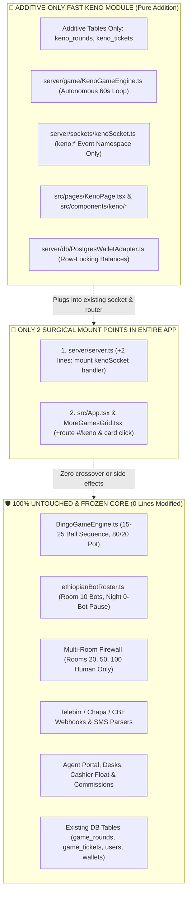

# 🛡️ Fast Keno Strict Non-Interference Production Implementation Plan
## 100% Additive Architecture • Zero-Touch Bingo Firewall • Pure Real Data • Isolated Neon Ledger

---

## 🚫 1. The Strict Non-Interference & Isolation Firewall (Golden Rules)

To ensure **Sonic Bingo, Multi-Room Mechanics, Cashier Rails, and Agent Portals remain 100% untouched and unaffected**, this implementation adheres to an uncompromising isolation firewall:



### 📋 The "Do NOT Touch" Ledger:
| Component / File | Permitted Modification | Non-Interference Guarantee |
| :--- | :---: | :--- |
| `server/game/BingoGameEngine.ts` | **STRICTLY 0% (0 lines)** | 15–25 ball win sequence, 80/20 pot distribution, and lobby countdown remain completely frozen. |
| `server/game/ethiopianBotRoster.ts` | **STRICTLY 0% (0 lines)** | 24-hour Ethiopian schedule and 01:00 AM – 06:00 AM zero-bot waiting state remain completely frozen. |
| Multi-Room Isolation (Rooms 20, 50, 100) | **STRICTLY 0% (0 lines)** | Remains strictly human-only P2P. Keno runs as its own separate game with zero bots. |
| `server/routes/webhooks.ts`, `telebirrParser.ts` | **STRICTLY 0% (0 lines)** | Deposit processing, SMS listener, and cashier approvals remain 100% frozen. |
| `src/components/agent/*`, `AgentPortalPage.tsx` | **STRICTLY 0% (0 lines)** | Agent desks, float balances, PWA modals, and fixed headers remain 100% frozen. |
| Existing DB Schema (`users`, `wallets`, `wallet_transactions`) | **STRICTLY 0 Alterations** | **NO `ALTER TABLE` ON EXISTING TABLES**. No schema migrations that drop or modify existing column constraints. |

---

## 🗄️ 2. Additive-Only Database Architecture (Zero Schema Changes to Existing Tables)

In the previous draft, an `ALTER TABLE wallet_transactions` was proposed. **That is now completely removed.** 

Instead:
1. Existing tables (`wallets`, `wallet_transactions`, `users`) remain **completely untouched**.
2. Fast Keno records standard financial transactions into `wallet_transactions` using the existing, already allowed enum types:
   - Debit: `type = 'bet'`, `description = 'Fast Keno Round #...'`
   - Credit: `type = 'win'`, `description = 'Fast Keno Round #...'`
3. We create **ONLY 2 NEW standalone tables** with `CREATE TABLE IF NOT EXISTS`:

```sql
-- server/db/migrations/20261117_production_keno_schema.sql
-- 100% ADDITIVE - Touches ZERO existing tables!

-- 1. Standalone Keno Rounds Table
CREATE TABLE IF NOT EXISTS keno_rounds (
    id UUID PRIMARY KEY DEFAULT gen_random_uuid(),
    round_number BIGSERIAL UNIQUE NOT NULL,
    status VARCHAR(20) NOT NULL DEFAULT 'betting' CHECK (status IN ('betting', 'drawing', 'settled', 'cancelled')),
    drawn_numbers INT[] DEFAULT '{}',
    server_seed VARCHAR(128) NOT NULL,
    server_seed_hash VARCHAR(64) NOT NULL,
    client_seed VARCHAR(64) NOT NULL DEFAULT 'sonic-bingo-public',
    nonce BIGINT NOT NULL,
    total_bets_count INT NOT NULL DEFAULT 0,
    total_wagered NUMERIC(12, 2) NOT NULL DEFAULT 0.00,
    total_payout NUMERIC(12, 2) NOT NULL DEFAULT 0.00,
    started_at TIMESTAMPTZ NOT NULL DEFAULT CURRENT_TIMESTAMP,
    drawn_at TIMESTAMPTZ,
    settled_at TIMESTAMPTZ
);

CREATE INDEX IF NOT EXISTS idx_keno_rounds_round_number ON keno_rounds(round_number DESC);
CREATE INDEX IF NOT EXISTS idx_keno_rounds_status ON keno_rounds(status);

-- 2. Standalone Keno Tickets Table
CREATE TABLE IF NOT EXISTS keno_tickets (
    id UUID PRIMARY KEY DEFAULT gen_random_uuid(),
    round_id UUID NOT NULL REFERENCES keno_rounds(id) ON DELETE CASCADE,
    round_number BIGINT NOT NULL,
    user_id UUID NOT NULL REFERENCES users(id) ON DELETE CASCADE,
    selected_numbers INT[] NOT NULL CHECK (array_length(selected_numbers, 1) BETWEEN 1 AND 10),
    spot_count INT NOT NULL CHECK (spot_count BETWEEN 1 AND 10),
    bet_amount NUMERIC(12, 2) NOT NULL CHECK (bet_amount >= 5.00 AND bet_amount <= 500.00),
    is_bonus BOOLEAN NOT NULL DEFAULT FALSE,
    hit_numbers INT[] DEFAULT '{}',
    hit_count INT NOT NULL DEFAULT 0,
    multiplier NUMERIC(8, 2) NOT NULL DEFAULT 0.00,
    payout_amount NUMERIC(12, 2) NOT NULL DEFAULT 0.00,
    status VARCHAR(20) NOT NULL DEFAULT 'active' CHECK (status IN ('active', 'won', 'lost', 'refunded')),
    created_at TIMESTAMPTZ NOT NULL DEFAULT CURRENT_TIMESTAMP,
    settled_at TIMESTAMPTZ
);

CREATE INDEX IF NOT EXISTS idx_keno_tickets_round_number ON keno_tickets(round_number);
CREATE INDEX IF NOT EXISTS idx_keno_tickets_user_id ON keno_tickets(user_id);
```

---

## ⚡ 3. Additive Backend Module (`server/game/KenoGameEngine.ts`)

### 1. Zero Mock Data / Zero Dummy Rounds
- **No `seedInitialHistory()`**: Removed.
- **No `MockWalletAdapter`**: Replaced with `PostgresWalletAdapter.ts`.
- **No `demo-user-1`**: Users authenticate via existing Telegram WebApp / JWT session.
- Rounds continue from actual database state:
  ```sql
  SELECT COALESCE(MAX(round_number), 0) + 1 AS next_round FROM keno_rounds;
  ```
- Hot & Cold statistics (last 100 rounds) query `keno_rounds` directly from Neon DB. If the database is brand new, it computes stats only from rounds that have actually finished.

### 2. Isolated Socket Event Namespace
All Keno events use the strict prefix `keno:*`, ensuring zero interference with bingo (`game:*` / `bingo:*`):
- `keno:join`
- `keno:init_state`
- `keno:round_started`
- `keno:tick`
- `keno:place_ticket`
- `keno:ball_drawn`
- `keno:round_settled`
- `keno:player_settled`
- `keno:verify_round`

### 3. Surgical Integration in `server/server.ts`
Only two lines added to `server/server.ts`:
```typescript
import { kenoEngine } from './game/KenoGameEngine.ts';
import { setupKenoSockets } from './sockets/kenoSocket.ts';

// Additive Keno handler on existing Socket.IO server (Bingo handlers completely untouched)
setupKenoSockets(io, kenoEngine);
```

---

## 📱 4. Additive Frontend Integration (Cloudflare Edge Safe)

### 1. Isolated Component Structure
All Keno code is housed in its own dedicated directory:
```text
src/
├── pages/
│   └── KenoPage.tsx                 # Dedicated Keno Game Route
├── components/
│   └── keno/                        # 100% Isolated Keno Components
│       ├── KenoGrid80.tsx           # 80-Ball number selector
│       ├── KenoBallTray.tsx         # Live ball reveal stage
│       ├── KenoBetSlip.tsx          # Stake selector & active tickets
│       ├── KenoOddsPaytable.tsx     # Dynamic multiplier matrix
│       ├── KenoRulesModal.tsx       # Rules & Provably Fair verification
│       └── WebAudioEngine.ts        # Zero-bandwidth Web Audio sound engine
└── context/
    └── KenoContext.tsx              # Connects to useApp() for real wallet & user ID
```

### 2. Surgical Route Integration
- In `src/App.tsx`:
  ```tsx
  {activeRoute === 'keno' && <KenoPage onBackToLobby={() => navigateTo('lobby')} />}
  ```
- In `src/components/games/MoreGamesGrid.tsx`:
  - Fast Keno badge updated from `SOON` to `LIVE`.
  - On click: `navigateTo('keno')` opens the game view directly without altering any other games.
- In `KenoPage.tsx`:
  - Features a prominent top button: **"⬅️ ወደ ቢንጎ ሎቢ ተመለስ / Back to Bingo Lobby"** to guarantee players can seamlessly return to Bingo at any time.

---

## 🔒 5. Financial Safety & Real Wallet Adapter (`server/db/PostgresWalletAdapter.ts`)

The adapter performs **real atomic balance transfers** on the existing `wallets` table without altering its schema:

```typescript
// Uses standard ACID transaction with row-level locks
export class PostgresWalletAdapter {
  async deductBet(userId: string, amount: number, roundNumber: number, isBonus: boolean) {
    return await withTransaction(async (client) => {
      const res = await client.query(
        `SELECT balance, bonus FROM wallets WHERE user_id = $1 FOR UPDATE`,
        [userId]
      );
      if (res.rows.length === 0) throw new Error('Wallet not found');

      const balance = parseFloat(res.rows[0].balance);
      const bonus = parseFloat(res.rows[0].bonus);
      const pool = isBonus ? bonus : balance;

      if (pool < amount) {
        return { success: false, error: 'Insufficient funds' };
      }

      const newBal = isBonus ? balance : balance - amount;
      const newBonus = isBonus ? bonus - amount : bonus;

      await client.query(
        `UPDATE wallets SET balance = $1, bonus = $2, updated_at = CURRENT_TIMESTAMP WHERE user_id = $3`,
        [newBal, newBonus, userId]
      );

      // Writes standard 'bet' to existing wallet_transactions
      const ref = `KENO_BET_R${roundNumber}_${Date.now()}`;
      await client.query(
        `INSERT INTO wallet_transactions (user_id, type, amount, balance_after, reference_code, description)
         VALUES ($1, 'bet', $2, $3, $4, $5)`,
        [userId, amount, newBal, ref, `Fast Keno Round #${roundNumber} Bet`]
      );

      return { success: true, balanceAfter: newBal, referenceCode: ref };
    });
  }

  async creditWin(userId: string, amount: number, roundNumber: number) {
    return await withTransaction(async (client) => {
      const res = await client.query(
        `SELECT balance FROM wallets WHERE user_id = $1 FOR UPDATE`,
        [userId]
      );
      const balance = parseFloat(res.rows[0].balance);
      const newBal = balance + amount;

      await client.query(
        `UPDATE wallets SET balance = $1, updated_at = CURRENT_TIMESTAMP WHERE user_id = $2`,
        [newBal, userId]
      );

      // Writes standard 'win' to existing wallet_transactions
      const ref = `KENO_WIN_R${roundNumber}_${Date.now()}`;
      await client.query(
        `INSERT INTO wallet_transactions (user_id, type, amount, balance_after, reference_code, description)
         VALUES ($1, 'win', $2, $3, $4, $5)`,
        [userId, amount, newBal, ref, `Fast Keno Round #${roundNumber} Win`]
      );

      return { success: true, balanceAfter: newBal, referenceCode: ref };
    });
  }
}
```

---

## 🧪 6. Invariant Verification & Multi-Suite Regression Testing

Before and after every implementation step, the system must pass **both the existing test suites AND the new Keno test suite**:

```bash
# 1. Existing Bingo & Bot Invariants (MUST REMAIN 100% PASSING)
npx tsx server/scripts/test_night_zero_bot_waiting.ts
npx tsx server/scripts/test_room10_hourly_schedule.ts
npx tsx server/scripts/test_phase3_dynamic_probability.ts
npx tsx server/scripts/test_agent_pwa_and_zero_regressions.ts

# 2. New Fast Keno Invariants (MUST PASS)
npx tsx server/scripts/test_keno_production_lifecycle.ts
# - Confirms real Neon DB round creation
# - Confirms atomic bet debit & win credit
# - Confirms provably fair cryptographic draw matches SHA-256 hash
# - Confirms zero mock balances or seed data

# 3. TypeScript Type Safety
npx tsc --noEmit

# 4. Vite Production Build
npm run build
```

---

## 🚀 Execution Phases (Step-by-Step)

| Phase | Action Item | Files Touched | Blast Radius |
| :---: | :--- | :--- | :---: |
| **Phase 1** | **Database Migration & Real Wallet Adapter**<br>Execute `20261117_production_keno_schema.sql` (additive tables `keno_rounds`, `keno_tickets`). Implement `server/db/PostgresWalletAdapter.ts`. | `server/db/migrations/20261117_production_keno_schema.sql`<br>`server/db/PostgresWalletAdapter.ts` | **ZERO** (New tables & new adapter file only) |
| **Phase 2** | **Production Game Engine & Sockets**<br>Mount `KenoGameEngine.ts` and `kenoSocket.ts` on the existing `io` instance. Remove fake seed history. | `server/game/KenoGameEngine.ts`<br>`server/sockets/kenoSocket.ts`<br>`server/server.ts` (+2 lines) | **ZERO** (Bingo engine & sockets untouched) |
| **Phase 3** | **Frontend UI & Audio Integration**<br>Move Keno components to `src/components/keno/` and `src/pages/KenoPage.tsx`. Connect to `useApp()` for real wallet. Unlock `MoreGamesGrid.tsx`. | `src/pages/KenoPage.tsx`<br>`src/components/keno/*`<br>`src/App.tsx` (+route)<br>`src/components/games/MoreGamesGrid.tsx` | **ZERO** (Bingo lobby, cartela & agent portal untouched) |
| **Phase 4** | **Full Audit & Automated Regression Suite**<br>Run `test_keno_production_lifecycle.ts` + all 4 existing Bingo test suites + `tsc --noEmit` + `npm run build`. | `server/scripts/test_keno_production_lifecycle.ts` | **ZERO** (Verification only) |

