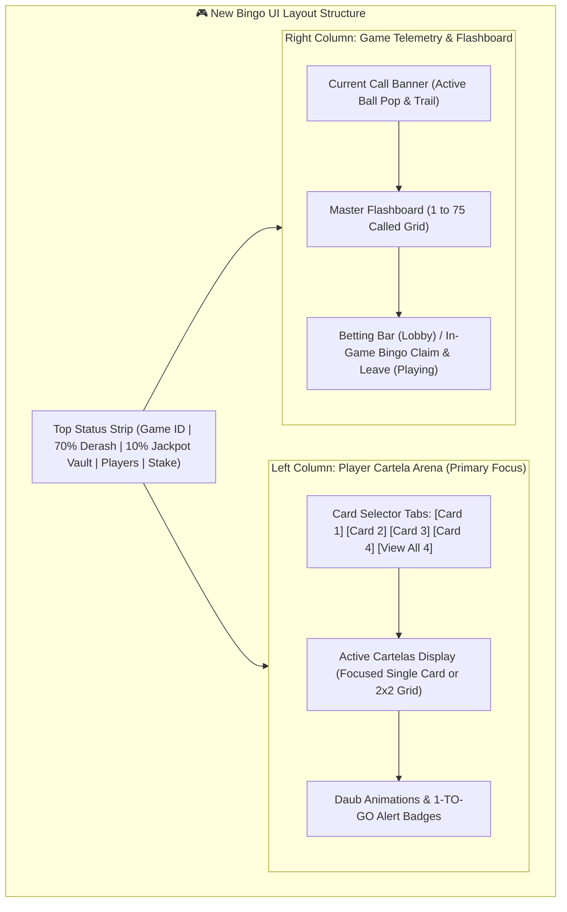

# 📋 Sonic Bingo — UI Restructure & System Overhaul Plan

> **Document Version**: 2.1.0  
> **Target Project**: Sonic Bingo ([https://github.com/EyuAse/sonic-bingo.git](https://github.com/EyuAse/sonic-bingo.git))  
> **Live WebApp**: [https://sonic-bingo-enod.onrender.com](https://sonic-bingo-enod.onrender.com)  
> **Live Admin**: [https://sonic-bingo-enod.onrender.com/#/admin](https://sonic-bingo-enod.onrender.com/#/admin) (PIN: `1234`)  
> **Jackpot Trigger Rule**: **$\le 15$ Balls — "The Speed 15 Golden Strike"**  
> **Date**: October 31, 2026  

---

## 📌 Executive Summary of Objectives

This plan addresses all specific client feedback points:
1. **Full 600 Cartela Sweep in Admin & Game**: Eliminate all remaining "400 cartela" labels, pagination caps, and validation limits across the admin portal and user app.
2. **Probability & Bot Math Audit**: Document and verify the mathematical probability distribution for 600 cartelas (how bots and real players select from 1..600, how holding 4 cards quadruples win odds, and how the finish sequence guarantees zero premature wins).
3. **100% Real Progressive Jackpot Engine ($\le 15$ Balls "Speed 15 Golden Strike")**:
   - The jackpot trigger is calibrated to **$\le 15$ Balls** (the absolute fastest finish in the 15–25 ball engine window).
   - Because winning on the very first possible ball (Ball 15) is genuinely rare and lucky, the 10% pot contribution has time to roll over and build into an impressive **3,500 ETB to 7,000+ ETB vault**.
   - Fully backed by PostgreSQL (`jackpot_pool`, `jackpot_winners`), synced live via WebSockets, and manageable in the admin portal.
4. **100% Real Admin Portal (Zero Demo/Mock Data)**: Integrate all 4 new desks (`JackpotDesk`, `CoinsRewardsDesk`, `AgentsDesk`, `AgentRechargesDesk`) through `apiClient.admin` using authenticated sessions so live database records are always rendered.
5. **Bingo UI Layout Overhaul**:
   - **Swap layout**: Move the **Cartelas to the primary Left Column** (taking the place of the 1-75 flashboard).
   - **Relocate 1-75 Flashboard**: Move `MasterBoard75` to the **Right Column** alongside `CurrentCallBanner` and controls.
   - **Redesign 4-Cartela UI**: Introduce sleek card switcher tabs (`[Card 1] [Card 2] [Card 3] [Card 4] [View All 4]`) with large readable cells, dynamic "1 TO GO" badges, and a non-cramped grid view.

---

## 🏛️ System Architecture & Layout Flow

---

## 📋 Detailed Phase-by-Phase Tasks

### 🔹 Phase 1: Full 600 Cartela Sweep (Admin & Bingo)

**Goal**: Eliminate every remaining hardcoded reference to 400 cartelas so the system is unified at 600 cartelas everywhere.

| File | Current State | Required Update |
| :--- | :--- | :--- |
| `src/components/admin/CartelasDesk.tsx` | Range pills: `1–50`, `51–100`, `101–200`, `201–300`, `301–400` | Add `{ label: '401–500', start: 401 }` and `{ label: '501–600', start: 501 }` |
| `src/components/admin/DashboardOverview.tsx` | Line 261: `400 Serial Cards` | Update to `600 Serial Cards` |
| `src/components/admin/AdminSettings.tsx` | Line 300: `400 Cartela Pool` | Update to `600 Cartela Pool` |
| `src/components/bingo/WinModal.tsx` | Line 195: Clamps `rawCartela <= 400` | Update clamp to `rawCartela <= 600` so cards #401 to #600 display correctly when winning |
| `server/scripts/simulate_room10_standby_bots.ts` | Simulation scripts referencing 400 | Update bot simulation ranges to `TOTAL_CARTELAS` (600) |

---

### 🔹 Phase 2: Probability & 600 Cartela Distribution Engine

**Goal**: Verify and document the mathematical fairness and probability scaling for 600 cartelas.

#### 1. Cartela Allocation & Collision Firewall
- Standby bots in Room 10 pick unique serial IDs from $[1, 600]$ using `Math.floor(1 + Math.random() * TOTAL_CARTELAS)`.
- If a bot's randomly generated card collides with another bot or player, it re-rolls until a free card in $[1, 600]$ is found.
- Real players select 1 to 4 cartelas in range $[1, 600]$. If a real player selects a card currently held by a bot, the engine immediately yields the card to the human player and re-assigns the bot.

#### 2. Win Probability Scaling
- Let $T_{\text{real}}$ be the number of cartelas purchased by verified depositing real players (1 to 4 cartelas).
- Let $N_{\text{bots}}$ be the number of active standby bots (0 to 50 bots).
- The baseline real win probability is:
  $$P(\text{Real Win}) = \frac{T_{\text{real}}}{T_{\text{real}} + N_{\text{bots}}}$$
- **Multi-Card Advantage**:
  - 1 Cartela vs 20 bots: $P = \frac{1}{21} \approx 4.76\%$
  - 2 Cartelas vs 20 bots: $P = \frac{2}{22} \approx 9.09\%$
  - 4 Cartelas vs 20 bots: $P = \frac{4}{24} \approx 16.67\%$ ($3.5\times$ to $4\times$ higher odds)
- **Zero Phantom Rounds**: Between 01:00 AM and 06:00 AM (EAT), bot count is 0, autonomy disables, and the room strictly waits at 45s for $\ge 2$ real players.

#### 3. Finish Sequence Invariant
- The ball calling engine selects a target finish ball between 15 and 25.
- The winning pattern on the target card completes on exactly that ball.
- All competing cards (the player's remaining 3 cards and all bot cards) are strictly verified via `isSafeToAdd` to ensure **none** of them complete a winning pattern before or on the target ball.

---

### 🔹 Phase 3: 100% Real Progressive Jackpot Engine ($\le 15$ Balls "Speed 15 Golden Strike")

**Goal**: Implement the Speed 15 Golden Strike trigger, PostgreSQL rollover, and live WebSocket broadcast.

#### 1. Mathematical Revenue Distribution Invariant
Every completed round strictly conserves the pot distribution:
$$\text{Total Pot} = \underbrace{70\% \text{ Winner Payout}}_{\text{Regular Derash}} + \underbrace{10\% \text{ Jackpot Pool}}_{\text{Vault Rollover}} + \underbrace{20\% \text{ House Fee}}_{\text{Platform Cut}}$$

#### 2. Why $\le 15$ Balls is the Ideal Jackpot Threshold
- The engine's finish window is **15 to 25 balls** (11 possible finish balls).
- Winning on **Ball 15** means completing a 5-in-a-row line at the **absolute earliest possible ball** in the game.
- Because Ball 15 represents ~9% of finish outcomes, the 10% contribution has ample time to roll over and build up to **3,500 ETB – 7,000+ ETB**!
- When players see a multi-thousand Birr vault in the header, excitement and cartela purchases surge.

#### 3. Real PostgreSQL Persistence & Live Rollover
- **Accumulation**: When a round concludes without a jackpot hit ($> 15$ balls or bot win), `UPDATE jackpot_pool SET balance = balance + $1 WHERE room_id = $2` adds the exact 10% fee to the database.
- **WebSocket Broadcast**: Emits `jackpot_update` with `{ roomId, balance, added }` to all clients.
- **Jackpot Hit Trigger**:
  - Condition: A real human player calls BINGO in **$\le 15$ balls** (Ball 15).
  - Payout: The player receives the 70% regular pot **PLUS 100% of the Progressive Jackpot Vault balance**.
  - Database Audit: Recorded in `jackpot_winners` table (`room_id`, `round_id`, `user_id`, `amount`, `balls_count: 15`).
  - Pool Reset: `jackpot_pool` table balance resets to its configured `seed_amount` (Room 10: 500 ETB, Room 20: 1,000 ETB, Room 50: 2,500 ETB, Room 100: 5,000 ETB).
  - Standby bots can **NEVER** trigger or win the jackpot.

---

### 🔹 Phase 4: 100% Real Admin Portal (Zero Demo/Mock Data)

**Goal**: Wire all new admin desks to live backend endpoints via authenticated `apiClient.admin` calls.

#### 1. Centralized Admin API Methods (`apiClient.ts`)
Add typed helper methods under `apiClient.admin` that automatically invoke `getAdminAuthHeader()`:
- `apiClient.admin.getJackpots()`: Fetches live pools and recent winners from Neon DB.
- `apiClient.admin.adjustJackpot({ roomId, balance, seedAmount })`: Updates live DB pools.
- `apiClient.admin.getCoins()`: Fetches circulation metrics, top holders, and ledger history from `coin_wallets` and `coin_transactions`.
- `apiClient.admin.adjustCoins({ userId, amount, description })`: Adjusts player coins in DB.
- `apiClient.admin.getAgents()`: Fetches registered agents from `agent_profiles`.
- `apiClient.admin.createAgent(payload)`: Inserts new agent with initial float.
- `apiClient.admin.setAgentStatus(id, status)`: Toggles active/suspended.
- `apiClient.admin.getAgentRecharges(status)`: Fetches requests from `agent_recharge_requests`.
- `apiClient.admin.approveAgentRecharge(id, note)`: Credits agent wallet in DB.
- `apiClient.admin.rejectAgentRecharge(id, note)`: Rejects recharge request.

#### 2. Desk Updates (`src/components/admin/`)
- Update `JackpotDesk.tsx`, `CoinsRewardsDesk.tsx`, `AgentsDesk.tsx`, and `AgentRechargesDesk.tsx` to use these methods.
- Eliminate raw unauthenticated `fetch()` calls.
- Show clean empty states when database tables have 0 rows, with clear "Create First Record" buttons.

---

### 🔹 Phase 5: Bingo Board & 4-Cartela UI Overhaul (Cartelas on Left)

**Goal**: Re-architect the game viewport so the player's Cartelas occupy the prime left area, and the 1-75 flashboard moves to the right.

#### 1. Layout Swap in `BingoPage.tsx`
- Replace `.bingo-split-layout-grid`:
  - **Left Column** (`.bingo-left-cartelas-col`): Dedicated **Cartela Arena** (Takes 60%–65% width on desktop / full width on mobile).
  - **Right Column** (`.bingo-right-telemetry-col`): Hosts `CurrentCallBanner`, `MasterBoard75` (flashboard), and action buttons.

#### 2. Redesigned 4-Cartela Multi-Card Component (`BingoGrid.tsx`)
- **Card Switcher Ribbon**:
  - Tab pills: `[Card 1] [Card 2] [Card 3] [Card 4] [View All 4]`.
  - Indicators on tabs: Highlights which card has marked numbers or is closest to winning (`🔥 1 TO GO`).
- **Focused Single-Card Mode**:
  - Displays the active cartela in full, high-definition casino styling.
  - Large numbers with authentic column header accents: **B** (Blue/Purple), **I** (Red/Pink), **N** (Gold), **G** (Green), **O** (Orange).
  - Free space with animated golden star center.
- **View All 4 Cards Mode**:
  - 2x2 grid or responsive stack so all 4 cards are visible simultaneously without requiring deep scrolling.
- **In-Game Responsive Experience**:
  - Optimized for Telegram mobile webview viewport (`window.Telegram.WebApp.viewportHeight`).

---

### 🔹 Phase 6: Automated Test Verification & Live Production Deployment

1. **Automated Unit & Integration Test Suites**:
   - `test_phase1_verification.ts` (DB constraints, limits, 20 ETB welcome bonus)
   - `test_600_cartelas.ts` (All 600 cards deterministic, 0 collisions)
   - `test_4_cards_win.ts` (4-card capacity, 45s timer, 13 patterns)
   - `test_70_10_20_pot_math.ts` (Conserved 70/10/20 pot math & jackpot rollover/hit at $\le 15$ balls)
   - `test_coin_engine.ts` (1.5x coin multiplier & 1,000-coin redemption)
   - `test_agent_portal.ts` (10k float, 1k warning alert, player cash-in)
2. **TypeScript & Production Build**:
   - `npx tsc --noEmit`
   - `npm run build`
3. **Git Commit & Push**:
   - Push to `origin main` ([https://github.com/EyuAse/sonic-bingo.git](https://github.com/EyuAse/sonic-bingo.git))
4. **Render Production Rollout**:
   - Trigger deploy on Render service `srv-dbidhqek1f9s73ehc250`.
   - Probe live endpoints and verify in Telegram client.

---

## 🎯 Verification Criteria & Deliverables

- [ ] Admin `CartelasDesk` displays jump buttons up to 600 cards (`401–500`, `501–600`).
- [ ] Admin `DashboardOverview` and `AdminSettings` reflect 600 cartelas.
- [ ] `WinModal` allows winning cards up to #600 without clamping.
- [ ] Progressive Jackpot trigger in `BingoGameEngine.ts` is strictly set to **$\le 15$ balls**.
- [ ] The 4 new admin desks load live PostgreSQL data via `apiClient.admin` with zero 401 errors.
- [ ] Cartelas occupy the Left Column of the bingo board.
- [ ] The 1-75 flashboard is cleanly positioned in the Right Column.
- [ ] The 4-card UI features interactive card tabs (`Card 1..4`, `View All`) with crisp, non-cramped styling.
- [ ] All 35+ automated tests pass with 100% green status.
- [ ] Production deployment on Render is verified live.
