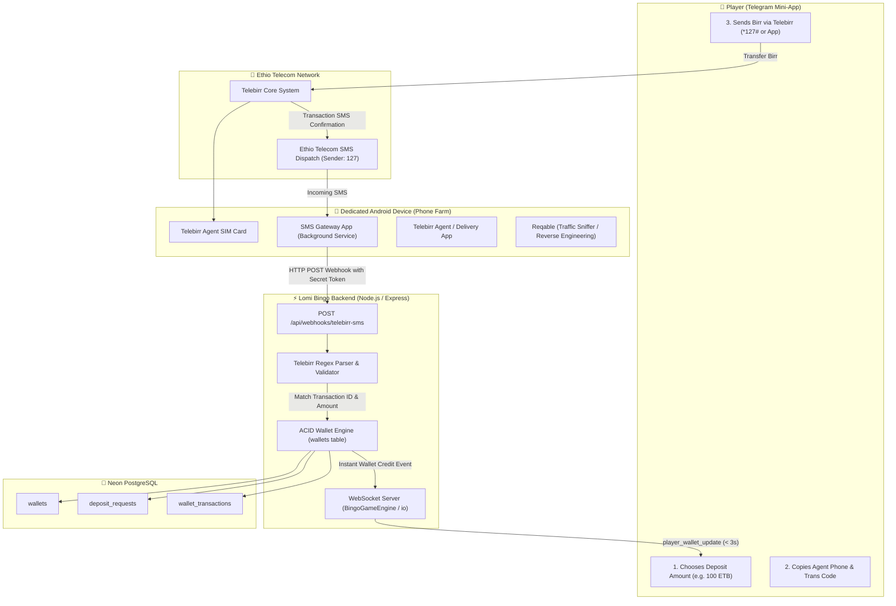

# 🚀 Telebirr Payment Automation: Architecture & Implementation Plan
### *Automating Deposits (Pay-in) and Withdrawals (Pay-out) for Lomi Bingo*

---

## 📌 1. What Is This & Why Did Your Boss Send It?

Your boss (Natan) sent you a blueprint for what the mobile gaming and betting industry in Ethiopia calls a **"SIM-Box / Android Phone Farm Automated Payment Bridge"**.

### 🔍 Background & The Real-World Problem:
In Ethiopia, integrating the **Official Telebirr H5 / Merchant Direct B2B API** requires:
- An official registered business license with the National Lottery Administration (Gambling & Gaming certification).
- Heavy financial auditing, bank escrow guarantees, and formal revenue-sharing agreements with Ethio Telecom.
- Weeks to months of bureaucratic review, with gambling platforms frequently being rejected.

### 💡 The Solution (Android SIM-Box Automation):
Instead of waiting for an official API, gaming operators run **one or more dedicated physical Android phones** inside their office/home with active Telebirr SIM cards. 

The image you provided shows the **exact 3 core applications** powering this pipeline:
1. 📩 **SMS Gateway** (Blue Mail Icon): An Android app (such as Capcom Android SMS Gateway or open-source equivalents) that runs as a persistent background service. Every time Ethio Telecom sends an SMS confirming an incoming Telebirr transfer, this app intercepts the text message and forwards it as an **HTTP POST webhook** directly to your backend server in real time.
2. 🔄 **Reqable** (Orange Hummingbird Icon): A mobile network proxy and packet inspection tool (similar to Charles Proxy, Fiddler, or Wireshark). Developers install Reqable on the phone to intercept and inspect encrypted HTTPS network traffic between the official Telebirr / Agent app and Ethio Telecom servers. This allows developers to reverse-engineer private API endpoints, headers, and authentication tokens to automate transfers programmatically without manual screen touches.
3. 💼 **Agent Delivery / Telebirr Agent App** (Green/Orange Swirl Icon): The actual Telebirr Agent/Merchant application holding the master bankroll/liquidity pool from which customer funds are received and payouts are disbursed.

---

## 🏛️ 2. High-Level System Architecture & Flow



---

## ⚖️ 3. Deep-Dive Analysis: The 3 Components

### A. Receiving Money (Deposit / Pay-in) — ⭐⭐⭐⭐⭐ (Highest Value, 100% Reliable)
* **How it works**:
  1. The player enters their deposit amount on Lomi Bingo. The app displays the Agent Telebirr number and a unique 6-character reference or instructions to transfer.
  2. The player transfers the funds using `*127#` or their Telebirr app.
  3. Ethio Telecom delivers an SMS to your Android device within 1–3 seconds:
     > *"You have received 100.00 ETB from 0912345678 (Abebe K). Transaction No: DA98KL78..."*
  4. **SMS Gateway** intercepts the message and fires an HTTP POST payload to `https://your-backend.com/api/webhooks/telebirr-sms`.
  5. Your server validates the secret token, extracts the **Transaction ID, Phone, and Amount**, checks against duplicates, credits the player's wallet, and pushes an instant WebSocket update.
* **Verdict**: **Industry standard, zero ban risk, 100% safe to automate.** Replaces manual cashier approvals instantly.

---

### B. Paying Out Money (Withdrawal / Payout) — ⚠️ (High Operational Care Required)
When a player clicks "Withdraw 200 ETB":
* **Approach 1: USSD Automation (`*127*1*PHONE*AMOUNT*PIN#`)**:
  - The server sends a payout job to the Android phone.
  - The Android phone runs an Accessibility or Telephony daemon that dials the USSD string.
  - **Pros**: Direct to SIM, does not rely on app updates.
  - **Cons**: Ethio Telecom USSD menus occasionally introduce confirmation steps ("Press 1 to confirm"), which can stall without interactive USSD handlers.
* **Approach 2: Android Accessibility UI Automation**:
  - An Android daemon taps the Telebirr Agent app, fills in the player phone number, enters the payout amount, inputs the PIN, and clicks Confirm.
  - **Pros**: Generates authentic app-level receipts.
  - **Cons**: If the phone locks, updates, or crashes, the UI automation stalls.
* **Approach 3: Reqable Sniffed API Replay (Headless API)**:
  - You sniff the Agent App's transfer endpoint using Reqable, capture the auth token, and call the endpoint directly from Node.js backend.
  - **Pros**: Fastest execution (sub-second payout).
  - **Cons**: Telebirr sessions expire every few hours; Ethio Telecom uses TLS fingerprinting and device binding. If tokens expire, withdrawals fail until re-authenticated.

> [!IMPORTANT]
> **Recommended Payout Strategy (2-Tier Guardrail)**:
> 1. **Phase 1 (Immediate)**: Keep deposits 100% automated via SMS Gateway, and keep withdrawals as **"1-Click Admin Approval"** where the admin taps "Pay" and the phone executes the transfer.
> 2. **Phase 2 (Full Auto)**: Enable automatic payout only for amounts $\le 500$ ETB with daily velocity limits (e.g., max 3 payouts per user/day), while routing larger withdrawals (> 1,000 ETB) to manual admin review to prevent wallet drains.

---

### C. Where Reqable Fits In
* **Reqable** is a desktop & mobile cross-platform packet inspector (combining Wireshark + Charles Proxy + Postman).
* **Why it is on this phone**:
  - The operator or developer uses Reqable to view the secret JSON payloads sent by the **Telebirr Agent / Delivery** app.
  - They capture:
    1. Base URL (e.g., `https://h5.ethiotelecom.et/...` or `https://agent.telebirr.et/...`)
    2. Headers (`X-Auth-Token`, `Device-ID`, `Signature`, `User-Agent`)
    3. Payload format for `p2p_transfer` or `agent_cash_out`.
  - With this data, a developer can either write a custom Node.js script to simulate the app or build a local bridge server on the phone.

---

## 🛠️ 4. Technical Implementation Specification

### Step 1: Database Migration for Webhook & SMS Tracking
We add a dedicated log table in Neon PostgreSQL to record every raw SMS received, ensuring **100% auditability and idempotency** (no double-crediting).

```sql
-- 1. Create table to store raw SMS logs from the Android SMS Gateway
CREATE TABLE IF NOT EXISTS telebirr_sms_logs (
    id SERIAL PRIMARY KEY,
    sender VARCHAR(50) NOT NULL,          -- e.g., '127' or 'telebirr'
    message_body TEXT NOT NULL,           -- Raw SMS content
    transaction_ref VARCHAR(100) UNIQUE,  -- Extracted Telebirr Transaction ID (DA98KL78)
    amount NUMERIC(10, 2),                -- Extracted amount (e.g. 100.00)
    payer_phone VARCHAR(50),              -- Extracted sender phone (e.g. 0912345678)
    status VARCHAR(50) DEFAULT 'unmatched', -- 'matched', 'credited', 'unmatched', 'duplicate'
    matched_user_id VARCHAR(100) REFERENCES users(id),
    matched_deposit_id INT REFERENCES deposit_requests(id),
    received_at TIMESTAMP WITH TIME ZONE DEFAULT NOW(),
    processed_at TIMESTAMP WITH TIME ZONE
);

CREATE INDEX IF NOT EXISTS idx_telebirr_sms_tx_ref ON telebirr_sms_logs(transaction_ref);
CREATE INDEX IF NOT EXISTS idx_telebirr_sms_phone ON telebirr_sms_logs(payer_phone);
```

---

### Step 2: Telebirr SMS Regex Parser (`server/services/telebirrParser.ts`)
Telebirr sends SMS confirmations in both English and Amharic formats:

```typescript
export interface ParsedTelebirrSMS {
  success: boolean;
  transactionRef?: string;
  amount?: number;
  senderPhone?: string;
  senderName?: string;
  balanceAfter?: number;
  rawText: string;
}

export function parseTelebirrSMS(smsBody: string): ParsedTelebirrSMS {
  const text = smsBody.trim();

  // Pattern 1: English Format
  // "You have received 100.00 ETB from 0912345678 (Abebe Kebede). Your current balance is ... Transaction ID: DA98KL78"
  const enRegex = /received\s+(?:ETB\s+)?([\d,]+(?:\.\d{1,2})?)\s*(?:ETB)?\s+from\s+([0-9+]+)(?:\s*\((.*?)\))?.*?Transaction\s*(?:ID|No|Number)?[:\s]+([A-Za-z0-9]+)/i;
  
  // Pattern 2: Amharic Format
  // "ከ 0912345678 (Abebe Kebede) 100.00 ብር ተቀብለዋል። የግብይት መለያ: DA98KL78"
  const amRegex = /ከ\s*([0-9+]+)(?:\s*\((.*?)\))?\s*([\d,]+(?:\.\d{1,2})?)\s*ብር\s*ተቀብለዋል።.*?የግብይት\s*መለያ[:\s]+([A-Za-z0-9]+)/i;

  let match = text.match(enRegex);
  if (match) {
    return {
      success: true,
      amount: parseFloat(match[1].replace(/,/g, '')),
      senderPhone: cleanPhoneNumber(match[2]),
      senderName: match[3]?.trim(),
      transactionRef: match[4]?.trim().toUpperCase(),
      rawText: text
    };
  }

  match = text.match(amRegex);
  if (match) {
    return {
      success: true,
      senderPhone: cleanPhoneNumber(match[1]),
      senderName: match[2]?.trim(),
      amount: parseFloat(match[3].replace(/,/g, '')),
      transactionRef: match[4]?.trim().toUpperCase(),
      rawText: text
    };
  }

  // Fallback: Generic Extraction of Tx ID & Amount
  const txMatch = text.match(/(?:Transaction\s*(?:ID|No|Number)?|የግብይት\s*መለያ)[:\s]+([A-Za-z0-9]{6,16})/i);
  const amtMatch = text.match(/([\d,]+(?:\.\d{1,2})?)\s*(?:ETB|ብር)/i);
  const phoneMatch = text.match(/(?:from|ከ)\s*(09\d{8}|07\d{8}|\+2519\d{8}|\+2517\d{8})/i);

  if (txMatch && amtMatch) {
    return {
      success: true,
      transactionRef: txMatch[1].trim().toUpperCase(),
      amount: parseFloat(amtMatch[1].replace(/,/g, '')),
      senderPhone: phoneMatch ? cleanPhoneNumber(phoneMatch[1]) : undefined,
      rawText: text
    };
  }

  return { success: false, rawText: text };
}

function cleanPhoneNumber(phone: string): string {
  let cleaned = phone.replace(/[\s-]/g, '');
  if (cleaned.startsWith('+251')) {
    cleaned = '0' + cleaned.slice(4);
  } else if (cleaned.startsWith('251')) {
    cleaned = '0' + cleaned.slice(3);
  }
  return cleaned;
}
```

---

### Step 3: Webhook Endpoint (`POST /api/webhooks/telebirr-sms`)
Add the webhook handler in Express with secret key authorization and ACID transaction execution:

```typescript
import { Router, Request, Response } from 'express';
import { query, withTransaction } from '../db.ts';
import { parseTelebirrSMS } from '../services/telebirrParser.ts';
import { io } from '../io.ts';
import { coinService } from '../services/coinService.ts';

const router = Router();
const SMS_GATEWAY_SECRET = process.env.SMS_GATEWAY_SECRET || 'lomi_bingo_super_secret_sms_bridge_2026';

router.post('/telebirr-sms', async (req: Request, res: Response) => {
  try {
    // 1. Verify Secret Header or API Key
    const incomingSecret = req.headers['x-gateway-secret'] || req.query.secret || req.body.secret;
    if (incomingSecret !== SMS_GATEWAY_SECRET) {
      return res.status(401).json({ success: false, error: 'Unauthorized SMS Gateway webhook request.' });
    }

    // 2. Extract Message payload (SMS Gateway sends sender and message body)
    const sender = req.body.from || req.body.sender || req.body.phone || '127';
    const messageBody = req.body.message || req.body.text || req.body.body || '';

    if (!messageBody) {
      return res.status(400).json({ success: false, error: 'Empty message body.' });
    }

    // 3. Parse Telebirr Details
    const parsed = parseTelebirrSMS(messageBody);
    if (!parsed.success || !parsed.transactionRef || !parsed.amount) {
      // Store unparsed SMS for administrative inspection
      await query(
        `INSERT INTO telebirr_sms_logs (sender, message_body, status) VALUES ($1, $2, 'unmatched')`,
        [sender, messageBody]
      );
      return res.json({ success: true, status: 'ignored', reason: 'Not a recognized Telebirr deposit SMS.' });
    }

    const { transactionRef, amount, senderPhone } = parsed;

    // 4. Atomic Execution: Check Idempotency & Match with User
    const creditResult = await withTransaction(async (client) => {
      // 4a. Check if this transactionRef has ALREADY been processed
      const existingCheck = await client.query(
        `SELECT id, status FROM telebirr_sms_logs WHERE transaction_ref = $1 FOR UPDATE`,
        [transactionRef]
      );

      if (existingCheck.rows.length > 0 && existingCheck.rows[0].status === 'credited') {
        return { status: 'already_processed', txRef: transactionRef };
      }

      // 4b. Find matching pending deposit request
      // Try exact transaction_ref match first OR (phone match + amount match within last 30 minutes)
      let depositRes = await client.query(
        `SELECT * FROM deposit_requests 
         WHERE status = 'pending' AND (
           transaction_ref ILIKE $1 
           OR (player_phone = $2 AND amount = $3 AND created_at >= NOW() - INTERVAL '30 minutes')
         )
         ORDER BY created_at DESC LIMIT 1
         FOR UPDATE`,
        [transactionRef, senderPhone || '', amount]
      );

      let userId: string | null = null;
      let depositId: number | null = null;

      if (depositRes.rows.length > 0) {
        // Matched an active pending deposit
        const dep = depositRes.rows[0];
        userId = dep.user_id;
        depositId = dep.id;
      } else if (senderPhone) {
        // Direct deposit without a pre-created ticket: Match by user registered phone
        const userRes = await client.query(
          `SELECT id FROM users WHERE phone = $1 OR phone = $2 LIMIT 1`,
          [senderPhone, senderPhone.replace(/^0/, '+251')]
        );
        if (userRes.rows.length > 0) {
          userId = userRes.rows[0].id;
        }
      }

      if (!userId) {
        // Log as unmatched so admin can manually link it if player claims it later
        await client.query(
          `INSERT INTO telebirr_sms_logs (sender, message_body, transaction_ref, amount, payer_phone, status)
           VALUES ($1, $2, $3, $4, $5, 'unmatched')
           ON CONFLICT (transaction_ref) DO NOTHING`,
          [sender, messageBody, transactionRef, amount, senderPhone || null]
        );
        return { status: 'unmatched', txRef: transactionRef, amount, phone: senderPhone };
      }

      // 4c. Lock and update player's wallet
      const walletRes = await client.query(
        `SELECT balance FROM wallets WHERE user_id = $1 FOR UPDATE`,
        [userId]
      );
      if (walletRes.rows.length === 0) {
        throw new Error(`Player wallet not found for user ${userId}`);
      }

      const prevBal = parseFloat(walletRes.rows[0].balance);
      const newBal = prevBal + amount;

      await client.query(
        `UPDATE wallets SET balance = $1, updated_at = NOW() WHERE user_id = $2`,
        [newBal, userId]
      );

      // 4d. Update or Insert deposit_requests
      if (depositId) {
        await client.query(
          `UPDATE deposit_requests 
           SET status = 'approved', transaction_ref = $1, reviewed_by = 'TELEBIRR_AUTO_ROBOT', reviewed_at = NOW() 
           WHERE id = $2`,
          [transactionRef, depositId]
        );
      } else {
        const newDep = await client.query(
          `INSERT INTO deposit_requests (user_id, amount, payment_method, player_phone, transaction_ref, status, reviewed_by, reviewed_at)
           VALUES ($1, $2, 'Telebirr', $3, $4, 'approved', 'TELEBIRR_AUTO_ROBOT', NOW())
           RETURNING id`,
          [userId, amount, senderPhone || 'Unknown', transactionRef]
        );
        depositId = newDep.rows[0].id;
      }

      // 4e. Record in ledger
      await client.query(
        `INSERT INTO wallet_transactions (user_id, type, amount, balance_after, reference_code, status, payment_method, description)
         VALUES ($1, 'deposit', $2, $3, $4, 'completed', 'Telebirr', $5)`,
        [userId, amount, newBal, transactionRef, `Automated Telebirr Deposit (${transactionRef})`]
      );

      // 4f. Mark user has_deposited & award coins
      await client.query(`UPDATE users SET has_deposited = TRUE WHERE id = $1`, [userId]);
      try {
        await coinService.awardCoinsForDeposit(userId, amount, transactionRef, client);
      } catch (cErr) {
        console.warn('⚠️ Coin reward notice:', cErr);
      }

      // 4g. Update SMS log to credited
      await client.query(
        `INSERT INTO telebirr_sms_logs (sender, message_body, transaction_ref, amount, payer_phone, status, matched_user_id, matched_deposit_id, processed_at)
         VALUES ($1, $2, $3, $4, $5, 'credited', $6, $7, NOW())
         ON CONFLICT (transaction_ref) DO UPDATE 
         SET status = 'credited', matched_user_id = $6, matched_deposit_id = $7, processed_at = NOW()`,
        [sender, messageBody, transactionRef, amount, senderPhone || null, userId, depositId]
      );

      return { status: 'credited', userId, newBal, amount, txRef: transactionRef };
    });

    // 5. Fire Real-Time WebSocket Updates
    if (creditResult.status === 'credited') {
      io.emit('player_wallet_update', {
        userId: creditResult.userId,
        balance: creditResult.newBal,
        amountAdded: creditResult.amount,
        type: 'deposit_auto_approved',
        reference: creditResult.txRef
      });
      io.emit('deposit_approved', {
        userId: creditResult.userId,
        amount: creditResult.amount,
        txRef: creditResult.txRef
      });
    }

    return res.json({ success: true, result: creditResult });
  } catch (error: any) {
    console.error('❌ [Telebirr SMS Webhook Error]:', error);
    return res.status(500).json({ success: false, error: error.message || 'Webhook processing failed.' });
  }
});

export const telebirrWebhookRouter = router;
```

---

## 🔒 5. Critical Security & Anti-Fraud Guardrails

1. **Anti-Duplication (Idempotency)**:
   - Ethio Telecom assigns a globally unique Transaction ID (`transaction_ref`, e.g., `DA98KL78`).
   - The PostgreSQL `telebirr_sms_logs` table enforces a `UNIQUE(transaction_ref)` constraint. Any duplicate webhook delivery from SMS Gateway is safely ignored.
2. **Webhook Shared Secret**:
   - The SMS Gateway app on the Android phone sends a custom header `X-Gateway-Secret: <SECRET_KEY>`. Any outside request without this header is rejected (`401 Unauthorized`).
3. **Player Phone Auto-Binding**:
   - When a player opens the Telegram Mini-App, their Telegram phone is retrieved or requested. If their Telegram phone matches the sender phone in the Ethio Telecom SMS, the deposit is matched with zero friction.
4. **Hot-Wallet Reserve Limit (Anti-Theft)**:
   - Never store more than **30,000 to 50,000 ETB** on the active automated SIM card. 
   - Every evening, manual or scheduled transfers should sweep excess balance into a secondary cold bank account (CBE / Personal Telebirr).
5. **Heartbeat Monitoring (Keep-Alive)**:
   - Android OS power-saving modes can put background apps to sleep. The SMS Gateway app must have **"Battery Optimization Disabled"** and run with a persistent foreground notification.
   - The backend runs a 5-minute health check: if no heartbeat is received from the device for 15 minutes during operating hours, an alert is sent to the Telegram Admin Channel.

---

## 📅 6. Phased Implementation Roadmap

| Phase | Milestone | Deliverable | Est. Time |
| :---: | :--- | :--- | :---: |
| **Phase 1** | **Automated Deposits via SMS Gateway** | DB migration (`telebirr_sms_logs`), SMS regex parser, `POST /api/webhooks/telebirr-sms` endpoint, and live testing with simulated SMS payloads. | **Day 1** |
| **Phase 2** | **Android Phone Configuration** | Install SMS Gateway on the physical phone, configure webhook destination (`https://.../api/webhooks/telebirr-sms`), enable battery bypass, test live 5 ETB transfer. | **Day 2** |
| **Phase 3** | **Admin Dashboard SMS Log View** | Add a tab in Admin Recharges / Dashboard displaying live incoming SMS logs, showing "Auto-Credited" badge and allowing 1-click manual match for unmatched deposits. | **Day 3** |
| **Phase 4** | **Withdrawal Payout Bridge** | Implement the Payout Queue daemon on the phone (Accessibility or USSD execution) with PIN security and daily velocity limits. | **Day 4–5** |
